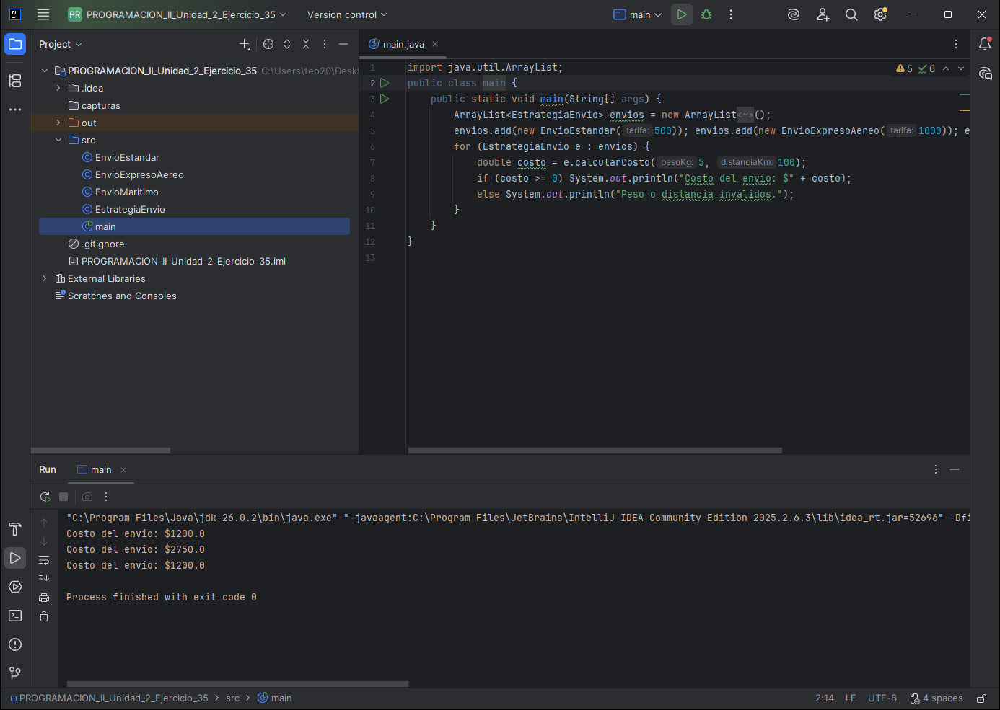

# PROGRAMACIÓN II — Unidad 2, Ejercicio 35: El Sistema de Cálculo de Costos de Envíos

Trabajo práctico de Programación II. Este repositorio contiene la resolución en Java del ejercicio 35 de la Unidad 2.

## Consigna

#### Contexto

Una empresa de logística internacional calcula la tarifa de envío de paquetes basándose en la modalidad de transporte elegida (envío postal estándar, expreso aéreo o transporte marítimo de carga pesada). Aplicar abstracción permite encapsular las fórmulas matemáticas de peso y distancia en componentes independientes.

#### Consigna

Implementar un sistema modular en Java que calcule el costo total de despacho de encomiendas aplicando reglas logísticas abstractas y polimórficas.

#### Desarrollo requerido

- Crear una clase abstracta EstrategiaEnvio con atributos comunes (tarifaBase) y un método abstracto double calcularCosto(double pesoKg, double distanciaKm).
- Desarrollar clases concretas hijas como EnvioEstandar, EnvioExpresoAereo y EnvioMaritimo que sobrescriban el método con factores de costo propios.
- Añadir validaciones para rechazar pesos negativos o distancias menores a cero.
- En el método main, crear una lista de envíos con distintas estrategias, recorrerlos modularmente y mostrar los costos calculados por consola.

## Estructura del repositorio

```
PROGRAMACION_II_Unidad_2_Ejercicio_35/
├── README.md
├── capturas/
│   └── consola.png
└── src/
    ├── EnvioEstandar.java
    ├── EnvioExpresoAereo.java
    ├── EnvioMaritimo.java
    ├── EstrategiaEnvio.java
    └── main.java   # clase con el método main
```

## Funcionamiento y lógica

El ejercicio usa una **clase abstracta** para calcular el costo de un envío según el medio de transporte.

### `EstrategiaEnvio` (clase abstracta)

Tiene una `tarifaBase` (`protected`) y el método abstracto `calcularCosto(double pesoKg, double distanciaKm)`.

### Estrategias concretas

Todas devuelven −1 si el peso o la distancia son negativos. Si no, calculan:

- **`EnvioEstandar`:** tarifa base + $100 por kg + $2 por km.
- **`EnvioExpresoAereo`:** tarifa base + $250 por kg + $5 por km.
- **`EnvioMaritimo`:** tarifa base + $80 por kg + $1 por km.

### `main`

Crea una lista con un envío estándar (base $500), uno aéreo (base $1000) y uno marítimo (base $700), y calcula el costo de un paquete de **5 kg** a **100 km** con cada uno. Si el costo es negativo informaría datos inválidos; en este caso los tres son válidos:

- Estándar: **$1200**
- Aéreo: **$2750**
- Marítimo: **$1200**

## Ejecución

Captura de la consola de IntelliJ IDEA ejecutando el programa:



Salida obtenida:

```
Costo del envío: $1200.0
Costo del envío: $2750.0
Costo del envío: $1200.0
```
